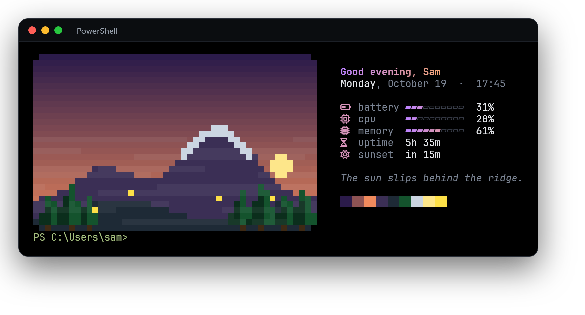
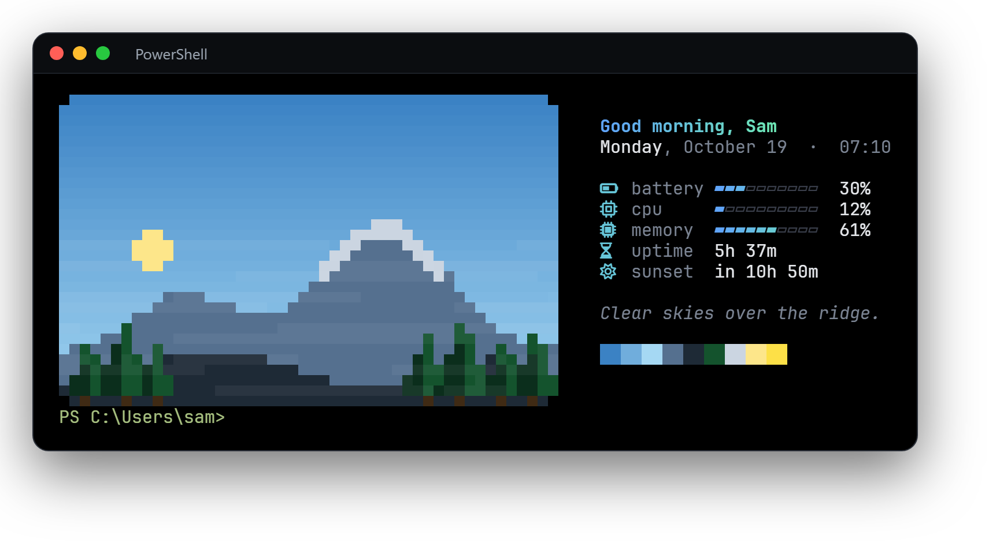
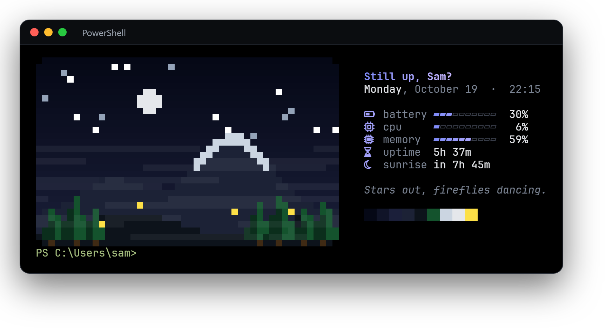

<div align="center">

# vista

**A living pixel landscape that greets you every time you open a terminal.**

Fog lifts off the mountains, the sun or moon sits where your real clock says it should,
stars twinkle at night and fireflies come out at dusk. Next to it, a small panel with
your battery, CPU, memory and how long until sunset, tinted in the colours of the sky.



</div>

## Install

**Windows (PowerShell):**

```powershell
irm https://raw.githubusercontent.com/trialdyk/vista-terminal/main/install.ps1 | iex
```

This downloads the latest release, puts `vista.exe` in `%LOCALAPPDATA%\Programs\vista`,
adds it to your PATH and runs `vista init`. Open a new terminal tab and it's there.

**With Rust installed:**

```bash
cargo install --git https://github.com/trialdyk/vista-terminal
vista init
```

**By hand:** grab `vista-x86_64-pc-windows-msvc.zip` (or the ARM64 one) from
[Releases](https://github.com/trialdyk/vista-terminal/releases), put `vista.exe` anywhere on your PATH and run `vista init`.

### What you need

- A terminal with true colour: [Windows Terminal](https://aka.ms/terminal) is perfect.
- A [Nerd Font](https://www.nerdfonts.com/) for the panel icons (the picture works without one).
  JetBrainsMono Nerd Font is a good pick.

## It follows the clock

The sky, the light and the greeting change through the day.

| Morning | Midday | Night |
|:---:|:---:|:---:|
|  |  |  |

Try it without waiting: `vista --demo` plays dawn, noon, sunset and night in a row,
and `vista --time 06:30` shows any moment you like.

## Shells

`vista init` finds your shells and adds a small, clearly marked block to each profile:

| Shell | Where the lines go |
|---|---|
| PowerShell 7 | `Documents\PowerShell\Microsoft.PowerShell_profile.ps1` |
| Windows PowerShell | its profile, only if you already have one |
| cmd | `clink_start.cmd`, if [Clink](https://chrisant996.github.io/clink/) is installed (cmd has no profile without it) |
| WSL (zsh / bash) | run `vista.exe init zsh >> ~/.zshrc` inside WSL |

Using Powerlevel10k in zsh? Put the vista lines at the **top** of `~/.zshrc`, above the instant prompt block.

To see the lines for one shell without changing anything: `vista init powershell` (or `cmd`, `bash`, `zsh`).

It stays out of the way: no animation in VS Code's terminal or over SSH, and opening a
new tab within 10 minutes of the last one shows the finished picture right away instead of the fog.

## Settings

`vista init` asks your name once. Everything lives in `%APPDATA%\vista\config.txt`:

```ini
name=Sam
# picture size in percent of the full 96x60 (20 to 100)
size=50
```

| Option | What it does |
|---|---|
| `--static` | final picture, no animation |
| `--animate` | always animate, even on a quick reopen |
| `--demo` | dawn, noon, sunset and night in a row |
| `--time HH:MM` | pretend it's this time |
| `--name NAME` | name in the greeting |
| `--size PERCENT` | picture size, 20 to 100 |
| `--ppm FILE` | save the picture as an image |

Turn it off for a moment with `VISTA_OFF=1` (`$env:VISTA_OFF = '1'` in PowerShell).

## Uninstall

```powershell
vista uninstall
```

This removes the vista block from every profile and deletes `%APPDATA%\vista`.
Then delete `vista.exe` (or `cargo uninstall vista-terminal`).

## How it works

The landscape is drawn at 96x60 pixels and printed with half-block characters (`▀`),
so every terminal cell holds two square pixels in 24-bit colour. Smaller sizes are
scaled with a priority rule so stars, fireflies, snow and the sun survive the shrink.
The panel reads the battery, CPU, memory and uptime straight from the Windows API.
It's a single small Rust program with no runtime and no config needed.

## Build

```bash
cargo build --release
cargo test
```

## License

[MIT](LICENSE)
